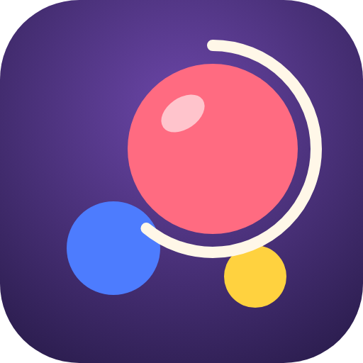
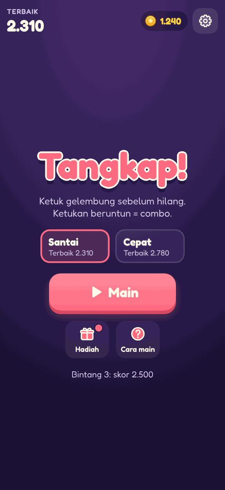
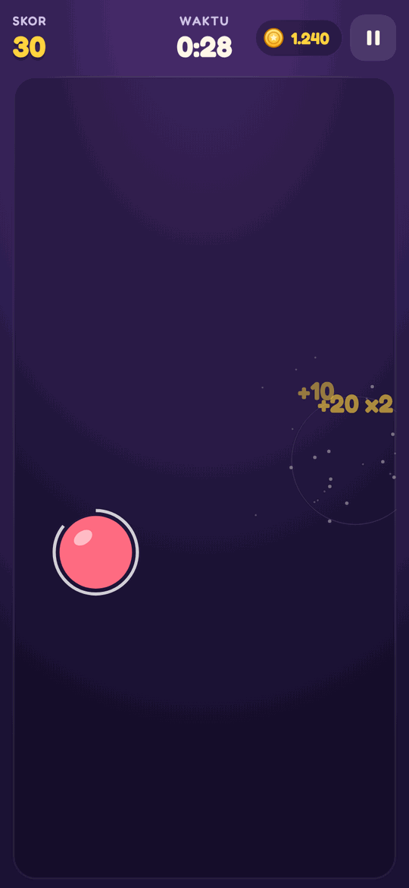
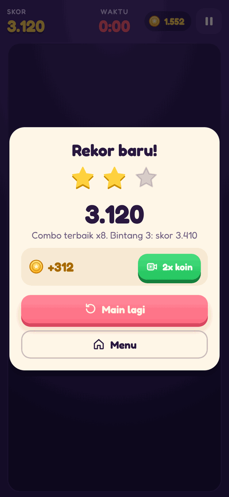
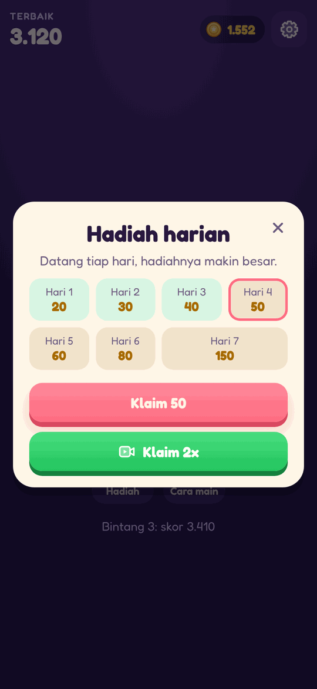

<div align="center">



# Tangkap!

**Ketuk cepat, sambung combo.**
Ketuk gelembung sebelum hilang, ketukan beruntun melipatgandakan skor sampai 8x.

[](https://lav-studio-org.github.io/NAMA-REPO/)

[](https://github.com/Lav-Studio-Org/NAMA-REPO/actions/workflows/test.yml)
[](https://github.com/Lav-Studio-Org/NAMA-REPO/actions/workflows/pages.yml)
[](https://github.com/Lav-Studio-Org/NAMA-REPO/releases)







</div>

## Cara main

1. Ketuk gelembung sebelum hilang. Cincin di sekelilingnya menunjukkan sisa waktunya.
2. Ketukan beruntun dalam waktu singkat memberi **combo**, skor naik sampai 8x.
3. Meleset atau membiarkan gelembung hilang memutus combo.
4. Kejar skor untuk bintang 1, 2, dan 3.

## Fitur

- **2 mode**: Santai dan Cepat, masing-masing dengan rekor sendiri.
- **Bintang 1 sampai 3** dengan ambang yang dihitung dari simulasi ratusan pemain.
- **Hadiah harian 7 hari**, koin, dan iklan berhadiah (2x koin, +10 detik).
- **Suara dan musik sintetis**, langsung di browser.
- **PWA**: bisa dipasang di layar utama dan dimainkan offline.

## Teknologi

HTML, CSS, dan JavaScript biasa. Tanpa build step, tanpa framework, tanpa library. Dunia game tetap 360 × 640 sehingga sama di semua layar.

| Path | Isi |
|---|---|
| `index.html`, `style.css` | Layar, sprite ikon `#i-*`, token warna |
| `js/engine.js` | Logika murni tanpa DOM (dipakai game, tes, dan simulasi) |
| `js/meta.js` | Profil, koin, hadiah harian, event bus, `track()` |
| `js/audio.js` | Efek suara dan musik (Web Audio) |
| `js/ads.js` | Lapisan iklan `GG.Ads` (iklan contoh di web) |
| `js/native.js`, `js/ads-config.js` | AdMob untuk versi Android (tidak aktif di web) |
| `js/game.js` | Alur game, canvas, dan UI |
| `scripts/` | Tes logika, balancing, smoke test, cek emoji, render ikon |

### Iklan

Placement berhadiah: `double_coins`, `revive`, `daily_double`. Interstitial `round_end` hanya di antara ronde: tidak di 3 game pertama, paling sering tiap 2 ronde, minimal 90 detik dari iklan lain.

## Jalankan lokal

```sh
git clone https://github.com/Lav-Studio-Org/NAMA-REPO.git
cd NAMA-REPO
python3 -m http.server 8123   # lalu buka http://localhost:8123/
```

### Tes dan skrip

```sh
node scripts/test-engine.js         # tes logika
node scripts/check-no-emoji.js      # tidak boleh ada emoji sebagai ikon
node scripts/balance.js 400         # simulasi pemain, cek peluang bintang (--write untuk menyimpan)
node scripts/smoke.js http://localhost:8123/ shots   # Playwright: main beberapa ronde + screenshot
node scripts/icons.js               # render icon.svg ke PNG
```

## Deploy dan rilis

- Setiap push ke `main` disalin ke branch `gh-pages` oleh `.github/workflows/pages.yml`, lalu disajikan di https://lav-studio-org.github.io/NAMA-REPO/.
- Rilis: naikkan `VERSION`, tambah `docs/releases/v<versi>.md`, naikkan `CACHE` di `sw.js`. Workflow `release.yml` membuat GitHub Release.

## Lisensi aset

Font [Fredoka](https://fonts.google.com/specimen/Fredoka) (SIL Open Font License). Semua grafis, ikon, dan suara dibuat khusus untuk game ini.
